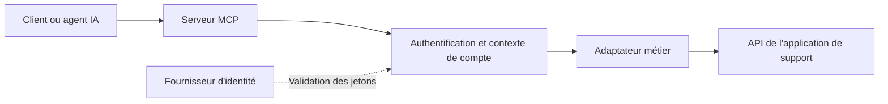

# Altores — Intégration MCP pour agents IA

**Jihane Belhoussine · Développement backend et intégration IA**  
TypeScript · Node.js · Model Context Protocol · API REST · Keycloak · OAuth 2.0 · Docker

## Présentation

J’ai contribué au développement d’un serveur **MCP (Model Context Protocol)** permettant à des agents IA de consulter les informations d’une application de support client à travers des outils structurés.

Le projet répond à un besoin d’intégration : rendre les données d’une application existante accessibles à un agent, tout en tenant compte de l’identité de l’utilisateur et du compte auquel il accède. Il s’appuie sur une API métier existante et sur une architecture séparant le serveur MCP de ses adaptateurs applicatifs.

Cette fiche présente mes contributions au projet Altores. Le code source et les ressources internes ne sont pas distribués dans ce dépôt.

## Mon périmètre de contribution

Les contributions ci-dessous sont retracées dans l’historique du projet sous mon nom, entre juillet et août 2026. Le travail s’inscrit dans un projet collectif ; les évolutions réalisées ultérieurement par les autres contributeurs ne sont pas présentées comme mes réalisations personnelles.

### 1. Exposer les données métier sous forme d’outils MCP

- Participation à l’extraction du serveur depuis l’application de support pour en faire un composant dédié.
- Adaptation du client HTTP à l’API métier et au mécanisme d’authentification retenu.
- Ajout d’outils de recherche et de consultation des conversations, contacts, agents et canaux de support.
- Ajout de la découverte des comptes accessibles à l’utilisateur.
- Recentrage du serveur sur des outils de lecture, en retirant les outils d’analyse IA intégrés lors d’une étape précédente.

Le périmètre documenté comprend **neuf outils** : comptes accessibles, transcriptions, rapports de satisfaction et indicateurs, recherche de conversations, détail d’une conversation, liste et détail des contacts, agents et canaux.

L’apport à l’IA se situe dans l’accès structuré aux données et l’intégration des agents. Ce projet ne correspond pas à l’entraînement d’un modèle de machine learning.

### 2. Intégrer l’authentification et le contexte de compte

- Intégration de Keycloak et de jetons JWT dans les échanges avec l’API métier.
- Raccordement du fournisseur d’authentification au transport MCP.
- Adaptation de l’extraction des informations d’authentification et du contexte de compte pour chaque requête.
- Ajout d’un mécanisme de découverte OAuth et de tests associés.
- Travail sur la configuration OAuth avec PKCE et sur la validation des adresses de redirection.
- Développement de mécanismes dédiés aux essais locaux, dont un parcours d’enregistrement dynamique de client en mode développement.

Un enjeu central était de distinguer **l’identité de l’utilisateur**, **le compte ciblé** et **les autorisations métier**. Le choix d’un compte ne doit pas être considéré comme une preuve que l’utilisateur est autorisé à accéder à ses données.

### 3. Améliorer les tests et l’observabilité

- Ajout de tests unitaires sur l’authentification, les erreurs et les schémas des outils.
- Ajout de tests sur l’extraction des informations d’authentification, les fournisseurs d’identité, les dates et la configuration.
- Ajout de tests du client HTTP avec des réponses simulées par Nock.
- Mise en place de journaux structurés avec Pino et d’un identifiant de corrélation des requêtes.
- Signalement d’un risque de résultats tronqués lorsque la limite de récupération des conversations est atteinte.
- Ajout d’un workflow GitHub Actions pour exécuter les tests Vitest.

### 4. Préparer le déploiement et la maintenance

- Travail sur les fichiers Docker et sur l’étape de compilation TypeScript.
- Corrections de la configuration de construction et de déploiement.
- Corrections de dépendances signalées par l’audit npm au cours du développement.
- Rédaction et enrichissement de la documentation : démarrage, déploiement, configuration de l’authentification, couverture de l’API et ajout d’un adaptateur.

## Architecture fonctionnelle

La séparation entre le cœur MCP et les adaptateurs permet d’isoler le transport et l’authentification de la logique propre à l’application. Le client métier assure les échanges HTTP ; les outils exposent des opérations définies et des paramètres structurés à l’agent.

## Technologies utilisées

| Domaine | Technologies et pratiques |
|---|---|
| Backend | TypeScript, Node.js, Express |
| Intégration des agents | SDK MCP, outils structurés, validation Zod |
| Accès aux données | API REST, Axios, application métier Ruby on Rails |
| Identité | Keycloak, OAuth 2.0, JWT, JWKS, PKCE |
| Tests | Vitest, Nock, Supertest |
| Exploitation | Docker, GitHub Actions, journaux Pino |

## Résultats et limites

Les livrables comprennent un serveur MCP avec un adaptateur métier, des outils de consultation, une intégration de l’authentification, des tests automatisés et une documentation technique.

La récupération des conversations présente une limite de volume dans la version étudiée : un avertissement de troncature améliore la visibilité de cette limite, mais ne remplace pas une pagination complète.

Le fonctionnement de bout en bout dépend des services métier et du fournisseur d’identité. Les tests reposant sur des réponses HTTP simulées vérifient des comportements ciblés et ne remplacent pas une validation dans l’environnement réel. Aucun chiffre de performance, de couverture de tests ou de gain métier non mesuré n’est revendiqué ici.

## Compétences mobilisées

- Concevoir une interface entre un agent IA et une application métier existante.
- Structurer un backend TypeScript autour de responsabilités distinctes.
- Traiter l’authentification et le contexte d’accès aux données dans une application à plusieurs comptes.
- Tester une intégration HTTP sans dépendre systématiquement des services distants.
- Documenter les choix techniques, les prérequis et les limites d’une intégration.
- Contribuer à un projet collectif avec Git, des tests et une intégration continue.

## Attribution et confidentialité

Projet réalisé dans le contexte Altores, à partir d’une application et de composants existants, avec plusieurs contributeurs. L’historique comporte également des contributions attribuées à un assistant de développement ; cette fiche ne les réattribue pas à mon travail personnel.

Ce dépôt contient uniquement cette présentation de portfolio. Il ne contient ni code Altores, ni historique du dépôt interne, ni données clients, ni paramètres d’accès aux services. Cette présentation ne confère aucun droit de redistribution sur le logiciel d’origine.

**Profil GitHub : [jbelhoussine](https://github.com/jbelhoussine)**
